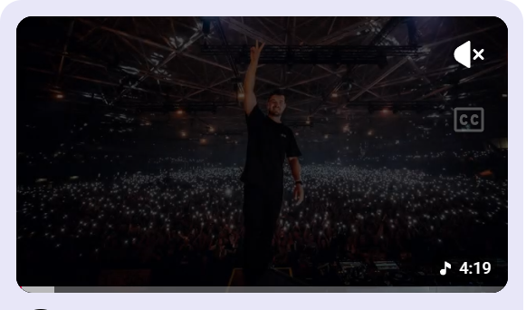
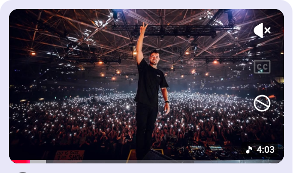

# YouTube: Not interested button

A userscript that adds a **Not interested** button to the hover preview on YouTube's home feed, right below the mute and CC buttons.

| Before | After |
| :---: | :---: |
|  |  |

## What?

Hovering over a video on the YouTube home page starts a preview with mute and CC buttons in the corner. This script adds a third button there, using YouTube's own styling and icon. Clicking it does exactly what **⋮ → Not interested** does: the card turns into *Video removed* with **Undo** and **Tell us why**.

## Why?

"Not interested" is the main way to tell YouTube what I don't want to see, but it is buried in the ⋮ menu: find the three dots, open the menu, find the right entry. That was enough friction that I rarely bothered, so my feed kept serving me the same things.

## So what?

Now I dismiss a video with one click, right on the preview I'm already watching.

## Installation

1. Install a userscript manager in your browser:
   - [Violentmonkey](https://violentmonkey.github.io/) (Firefox, Chrome, Edge), or
   - [Tampermonkey](https://www.tampermonkey.net/) (Firefox, Chrome, Edge, Safari). On Chrome, also turn on **Allow User Scripts** in the extension's details page.
2. Open [`youtube-not-interested-button.user.js`](youtube-not-interested-button.user.js) on GitHub and click **Raw**.
3. Your userscript manager shows an install page: click **Install**.
4. Reload YouTube and hover over any video on the home page.

## Notes

- Works in any YouTube language: the menu entry is found by its icon, not its text.
- YouTube changes its markup from time to time. If the button stops appearing, the class names in the script are what need updating.
